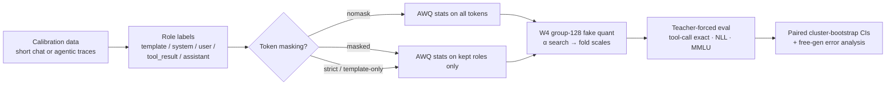
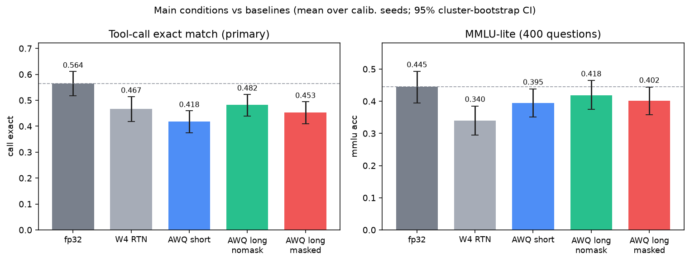
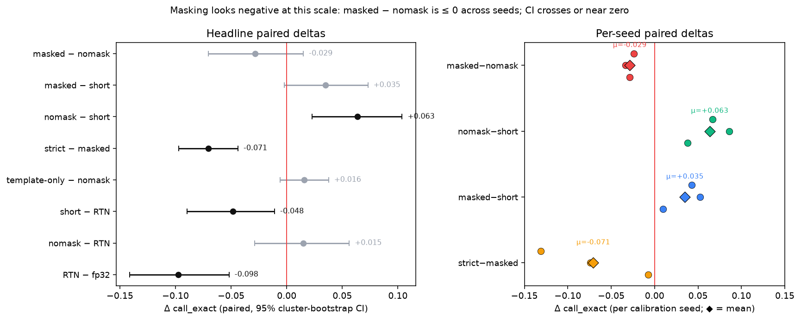
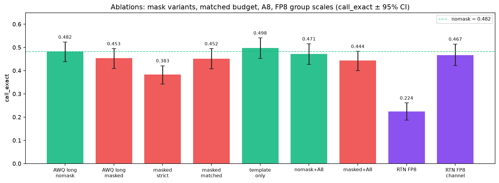
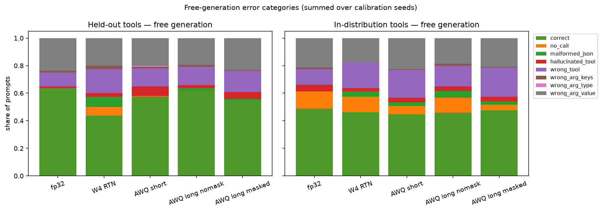

# Agentic AWQ token masking: a CPU quality-recovery study

Cohere's W4A8 post ([vLLM integration and quality-recovery techniques](https://cohere.com/blog/vllm-integration-and-quality-recovery-techniques-explained))
lists *AWQ token masking* as one of the fixes that made 4-bit weights work on long agentic workloads:
when you calibrate on agentic traces, the long system prompt and tool-schema tokens dominate the
activation statistics, so the scales AWQ picks fit the template rather than the content the model
actually has to produce. This repo reproduces that **diagnosis** on a small open model on CPU, with
no Hopper kernels: W4 is simulated by fake quantization (dequantized weights), which preserves the
numerics of the rounding while skipping the speed-up.

**Headline (negative result at this scale).** On Qwen2.5-0.5B-Instruct, calibrating AWQ on long
agentic traces **with** system/tool-template tokens masked out does **not** beat the same traces
without masking. Paired tool-call exact match
`awq_long_masked − awq_long_nomask = −0.029 [−0.070, +0.015]` (95% cluster-bootstrap CI; mean over
3 calibration seeds). Long calibration without masking *does* beat short-chat calibration
(`awq_long_nomask − awq_short = +0.063 [+0.023, +0.104]`). Stricter masking is worse still
(`awq_long_masked_strict − awq_long_masked = −0.071 [−0.097, −0.044]`). Full tables:
[`results/summary.md`](results/summary.md).

## Pipeline



## At-a-glance results

Primary metric: **tool-call exact match** on 200 held-out synthetic agentic episodes (teacher-forced
over every `<tool_call>` span). Numbers from `results/summary.md` after
`uv run python -m src.summarize`.

| condition | seeds | call_exact | call NLL/tok | MMLU-lite |
|---|---:|---|---|---|
| fp32 | 1 | 0.564 [0.518, 0.611] | 0.079 | 0.445 [0.395, 0.493] |
| W4 RTN | 1 | 0.467 [0.418, 0.514] | 0.117 | 0.340 [0.295, 0.385] |
| AWQ short-chat | 3 | 0.418 [0.374, 0.459] | 0.102 | 0.395 [0.352, 0.438] |
| AWQ long, no mask | 3 | **0.482** [0.439, 0.523] | 0.094 | 0.418 [0.375, 0.464] |
| AWQ long, masked | 3 | 0.453 [0.409, 0.494] | 0.103 | 0.402 [0.357, 0.444] |
| masked, strict (user+asst only) | 3 | 0.383 [0.342, 0.421] | 0.119 | 0.396 [0.355, 0.439] |

| paired Δ call_exact (A − B) | estimate [95% CI] |
|---|---|
| masked − nomask | **−0.029 [−0.070, +0.015]** |
| masked − short | +0.035 [−0.002, +0.073] |
| **nomask − short** | **+0.063 [+0.023, +0.104]** |
| strict − masked | −0.071 [−0.097, −0.044] |
| RTN − fp32 | −0.098 [−0.141, −0.052] |







On a **held-out-tools** split (10 tools never seen in calibration; see
[`results/heldout_summary.md`](results/heldout_summary.md)), the same story is stronger: paired
teacher-forced call exact `masked − nomask = −0.051 [−0.089, −0.010]`. Free-generation correct rate
on held-out tools: nomask 62% vs masked 55% (fp 64%, RTN 44%).



## Question

On Qwen2.5-0.5B-Instruct quantized to W4 (group 128), does calibrating AWQ on long agentic traces
**with system/tool-template tokens masked out** recover more tool-calling quality than (a) the usual
short-chat calibration set and (b) the same agentic traces without masking?

**Answer here:** (b) no — masking is negative or null (CI crosses zero on the main grid; significantly
negative on held-out tools). (a) long calibration without masking *does* beat short-chat calibration.

## Setup

| piece | choice |
|---|---|
| model | `Qwen/Qwen2.5-0.5B-Instruct` @ `7ae5576`, fp32 on CPU (4 threads) |
| weights | W4 asymmetric, group 128, round-to-nearest after AWQ scaling (`src/quant.py`) |
| AWQ | minimal reimplementation: per group input, `s = mean\|x\|^α`, α ∈ {0, 0.05, …, 0.95}, pick α minimising output MSE on 1,024 calibration token rows; scales folded into RMSNorm (q/k/v, gate/up) or `up_proj` rows (`down_proj`). `o_proj` is RTN only (GQA prevents folding into `v_proj`). No clipping search. |
| token masking | the statistic `mean\|x\|` **and** the reconstruction rows use only tokens whose role is kept |
| calibration budget | 16,384 raw tokens per condition (sequences ≤ 2,048), 3 calibration seeds |
| agentic traces | synthetic, `src/data.py`: 12 tools with JSON schemas, 6–12 offered per episode, 1–3 rounds of user request → `<tool_call>` → `<tool_response>` → answer, rendered with Qwen's own tool chat template. In the calibration set ~80% of tokens are system/tool-schema tokens. |
| short-chat calibration | Alpaca rows (first half), rendered with the chat template |

Every token carries a role label (`template`, `system`, `user`, `tool_result`, `assistant`), derived
from character offsets of the rendered chat (tested in `tests/test_core.py`).

### Conditions

| condition | calibration | roles in AWQ statistics |
|---|---|---|
| `fp` | – | – (fp32 reference) |
| `rtn` | – | – (W4 round-to-nearest, no AWQ) |
| `awq_short` | short chat | all |
| `awq_long_nomask` | agentic traces | all |
| `awq_long_masked` | agentic traces | user + assistant + tool_result (system and template masked) |
| ablation `awq_long_masked_strict` | agentic traces | user + assistant only |
| ablation `awq_long_masked_matched` | agentic traces | as masked, but 16,384 **kept** tokens (more episodes) |
| ablation `awq_long_template_only` | agentic traces | system + template only (the inverse mask) |
| ablation `*_a8` | as above | plus dynamic per-token int8 activations (the A8 of W4A8) |
| ablation `rtn_fp8`, `rtn_fp8_channel` | – | group scales stored as FP8 e4m3: naive cast vs fp8 ratio to an fp32 per-channel scale (the post's channel-scale fix) |

### Metrics (all paired: every condition sees the same evaluation items)

* **Tool-call exact match** (primary, agentic): 200 held-out synthetic episodes (seed disjoint from
  calibration). For every assistant `<tool_call>` span, teacher-forced: the call is exact iff the
  argmax equals the gold token at every position.
* Tool-call NLL per token, and final-answer NLL per token.
* Short-chat NLL per token: 150 held-out Alpaca answers.
* MMLU-lite: 400 random MMLU test questions, zero-shot, letter argmax.
* Held-out-tools split + free generation: see `src/heldout.py` and
  [`results/error_analysis.md`](results/error_analysis.md).

Uncertainty: 95% cluster bootstrap over evaluation episodes (2,000 resamples; ratio of sums per
resample), averaged over the 3 calibration seeds; paired deltas resample the same items for both
conditions. Seed-to-seed SD is reported separately in `results/summary.md`.

## Error analysis (brief)

Free generation after a user request (greedy first call), categories in
[`results/error_analysis.md`](results/error_analysis.md). On held-out tools, quantization mainly
adds **wrong_tool** / **wrong_arg_value** (and some `malformed_json` / `no_call` under RTN). Masking
does not reduce those failure modes vs nomask; it lowers the correct share (55% vs 62%). On
in-distribution prompts the gap is smaller. Spot-check examples:
[`results/heldout_examples.md`](results/heldout_examples.md).

## Reproduce

```bash
./reproduce.sh            # main grid (~1 h on 8 CPU cores; resumable) → summarize + figures
./reproduce.sh ablations  # mask / A8 / FP8 ablations → summarize + figures
./reproduce.sh heldout    # held-out-tools + free-gen → report + figures
./reproduce.sh smoke      # unit tests + tiny run; regenerates docs/figures/ if summary.json exists
uv run pytest -q
uv run python -m src.summarize   # tables from results/raw
uv run python -m src.figures     # docs/figures/*.png from summary / heldout JSON
uv run python -m src.mechanism   # activation-statistic decomposition by role
```

`reproduce.sh` does `uv sync --frozen` (CPU torch from the PyTorch index, pinned in `uv.lock`),
downloads MMLU and Alpaca parquet files and checks their sha256, skips finished cells, then writes
tables and **regenerates** `docs/figures/` from those results. Figures are produced only from real
JSON under `results/` — never hand-edited.

## Limitations

* Fake quantization: no INT4/FP8 kernels, so no latency numbers; only quality.
* A 0.5B model and a synthetic, templated agentic distribution. The held-out-tools split addresses
  tool identity leakage; request templates still share structure with calibration.
* Minimal AWQ (no clipping search, `o_proj` not scaled); absolute recovery will differ from AutoAWQ /
  llm-compressor, but every condition uses the same quantizer, so the comparisons are like for like.
* Negative masking result may not transfer to larger models / real customer traces / production AWQ
  stacks — this study only claims what the numbers above show at 0.5B on CPU.

## Layout

`src/data.py` traces and role labels · `src/quant.py` quantizer, AWQ, masking, A8, FP8 scales ·
`src/run.py` one condition end to end · `src/summarize.py` tables and paired bootstrap ·
`src/figures.py` README PNGs under `docs/figures/` · `src/heldout.py` / `src/report.py` held-out tools
and error analysis · `tests/` · `reproduce.sh`.

## License

MIT
